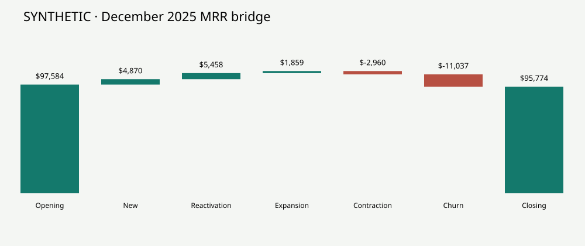

# Subscription Revenue & Retention Analysis

**SQL · Python · SQLite · Interactive dashboard | Synthetic portfolio case study**

## Business question
Why can a subscription company acquire customers while recurring revenue declines?

This project builds an auditable analysis from synthetic customer, subscription, event, invoice, payment, and product-usage records. It separates recurring revenue, invoiced charges, and collected cash, then identifies the movements behind declining MRR.

> All data is synthetic. Behavioral relationships are intentionally encoded in the generator. Results demonstrate analytical methods, not actual customer behavior or achieved business impact.



## Executive findings — December 2025
- Paying customers increase from **650 to 660**, including **52 new month-end payers**.
- MRR falls **$1,810 (1.9%)**, from **$97,584 to $95,774**.
- Payment-failure cancellations account for **53.5% of churn plus contraction MRR loss**.
- Net revenue retention is **87.6%**; gross revenue retention is **85.7%**.
- Existing-customer expansion adds **$1,859 MRR**, insufficient to offset churn and contraction.
- All **24 monthly revenue bridges reconcile to zero cents**.

Displayed dollars are rounded; calculations use cents.

## Start here
1. Read the [executive brief](dist/downloads/executive-brief.md).
2. Download or clone this repository, then open **`dist/index.html`** in a browser for the interactive dashboard. GitHub's file viewer shows source rather than running the dashboard.
3. Inspect the [SQL transformations](sql/analysis.sql) and [Python generator](python/generate.py).
4. Read the [full analysis and metric contract](dist/downloads/executive-report.md).

The dashboard includes monthly MRR movements, plan-level churn, channel and feature-activation retention, and intervention sliders. December 2025 is the default month. Retention uses the complete eligible history independently of the month selector.

## What the project demonstrates
- Event-based month-end customer subscription snapshots.
- Reconciled opening, new, reactivation, expansion, contraction, churn and closing MRR.
- Customer churn versus revenue churn, with opening-plan attribution.
- Landmark retention analysis with explicit eligibility, censoring and Wilson intervals.
- A 10,000-draw customer-level intervention simulation with uncertain efficacy.
- Executive communication with prioritized, testable interventions.

## Reproduce the analysis
Requires **Python 3.10+**. Uses the standard library only; no package installation or API keys.

From the repository folder:
```sh
python3 python/generate.py
python3 python/analyze.py
```

Generation replaces the synthetic SQLite database and CSV/JSON outputs. The generator uses seed **7142025**; scenarios use **7142026**. Generation can take about a minute depending on the computer. Open `dist/index.html` afterward. The included executive brief is a curated summary of the fixed-seed baseline; recheck it if you change generator assumptions.

Run analytical regression tests with `python3 -m unittest discover -s tests -v`. The analysis preserves this README and regenerates the executive brief from current metrics.

Optional: `python3 python/package.py` rebuilds the downloadable project ZIP.

## Project structure
```text
README.md
subscription_analytics.sqlite    Raw tables and modeled outputs
sql/analysis.sql                 Executable SQLite transformations
python/generate.py               Data generation, exports, retention, checks
python/analyze.py                Report, SVG charts and Monte Carlo scenarios
python/package.py                Portable project bundle
dist/
  index.html                     Offline interactive dashboard
  app.js                         Dashboard interactions and charts
  data.js                        Generated dashboard data
  downloads/                     CSVs, report, charts, metrics and scenarios
 docs/
  data-dictionary.md             Table grains and relationships
  interview-notes.md             Questions to prepare for
```

## Data and validation
The baseline contains **2,665 customers**, **20,728 invoices**, **8,096 subscription events**, and **45,090 customer-month snapshots** across January 2024–December 2025.

Validation checks cover all 24 MRR bridges, unique customer-month grain, invoice/payment reconciliation, event/subscription ownership, and presence of the requested complications. See [validation results](dist/downloads/validation.json) and the [data dictionary](docs/data-dictionary.md).

## Metric definitions
| Measure | Definition |
|---|---|
| MRR | Month-end active monthly contracted price, net of recurring discounts. Trials and cancelled service contribute zero. |
| Invoiced charges | Daily prorated service charges, rounded once per customer/month and billed in arrears. Not GAAP recognized revenue. |
| Collected cash | Payments whose receipt date falls in the month, including payments against prior invoices. |
| GRR | (Opening MRR − contraction − churn) / opening MRR. |
| NRR | (Opening MRR + expansion − contraction − churn) / opening MRR. |
| Customer churn | Opening payers ending at zero MRR / opening payers. |
| Revenue churn | Opening MRR lost from those churned customers / opening MRR. Excludes contraction. |

New MRR is the first positive month-end snapshot. Reactivation requires an earlier positive month-end and zero opening MRR. Expansion and contraction are net changes among customers paying at both endpoints; expansion includes discount expiry. New and reactivated customers are excluded from NRR. Retention ratios are undefined when opening MRR is zero.

## Assumptions and limitations
- Trials, discounts, failed payments, reactivations, and mid-month plan changes are included.
- Payment failure reduces cash; MRR changes only upon service cancellation.
- December open invoices fall outside the cash observation window and are not automatically failures.
- Activation means publishing a workflow by day 14; retention starts from a common day-30 paying-customer landmark. It measures point-in-time paid status, including reactivation, rather than uninterrupted survival.
- Channel and activation comparisons are descriptive, confounded by customer mix, and partly determined by generator assumptions.
- Scenario outcomes assume one-month rescue at opening MRR. Costs, cash uplift and compounding are excluded. Their ranges are model sensitivities, not real-world confidence bounds.
- No annual billing, taxes, refunds, currency conversion, or accounting revenue recognition is modeled.

## Data provenance

All data is synthetic. Review the code, metric definitions, and assumptions alongside the reported results.
